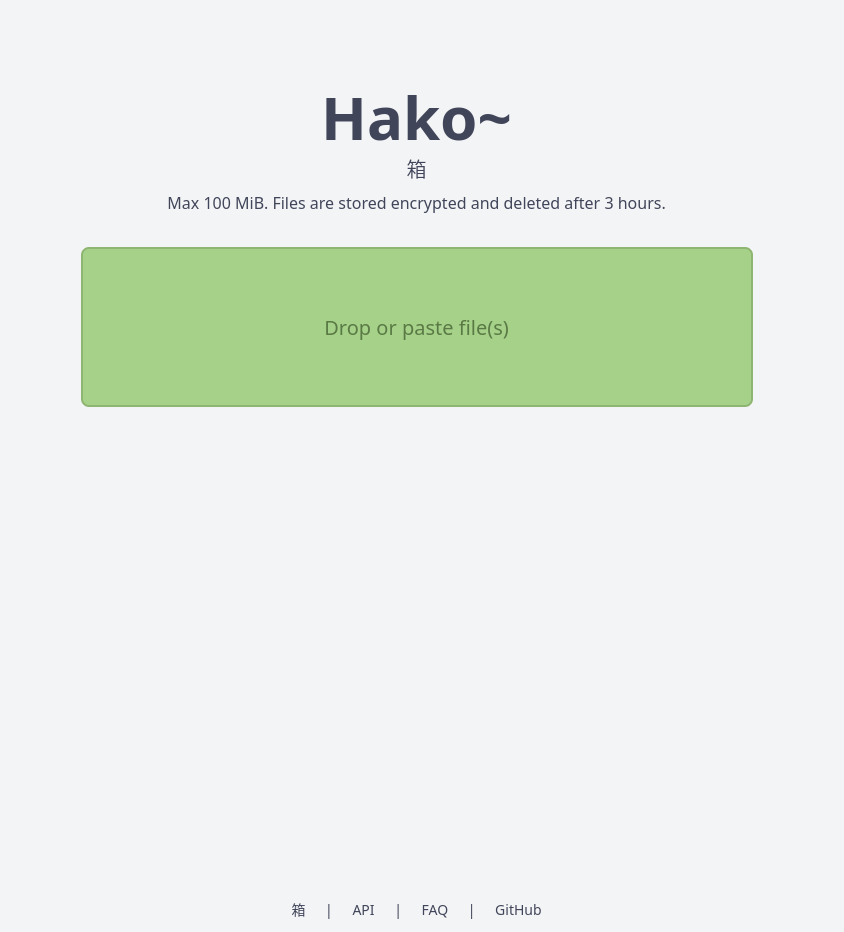

<div align="center">

# Hako 箱

**Ephemeral file sharing — no accounts, encrypted at rest, gone by expiry.**

[](https://www.rust-lang.org)
[](https://actix.rs)
[](https://kit.svelte.dev)
[](https://www.sea-ql.org/SeaORM/)
[](#-security)
[](LICENSE)



</div>

---

## ✨ Features

| | |
|---|---|
| 🔐 **Encrypted at rest** | Files *and* sensitive metadata (name, path) sealed with AES-256-GCM |
| 🕵️ **No accounts** | No sign-up, no auth — IPs are only ever stored as keyed HMAC digests |
| ⏳ **Self-destructing** | Configurable expiry with a background cleanup task |
| 📋 **Drop or paste** | Drag-and-drop or paste straight from the clipboard, one file per upload |
| 🧱 **Hardened** | Deny-by-default response types, filename sanitization, streaming size caps, opaque errors |
| 🚫 **No third parties** | Fonts and assets are self-hosted; a page load talks to nobody but this server |
| ⚡ **Fast** | Gzip, connection pooling, precompiled regex, per-CPU workers, cached assets |

## 🚀 Quick Start

### Docker Compose — recommended

```bash
# Generate a key — 24 random bytes encode to exactly the 32 characters Hako uses
export ENCRYPTION_KEY=$(openssl rand -base64 24)

docker compose up -d
```

Hako is live at **http://localhost:9090**.

Skip the key and it still starts, on a placeholder key published in this repository —
the server warns on every start and the UI carries a banner until you set a real one.
Keep the value somewhere safe: **changing it makes existing uploads permanently
undecryptable**, so generate it once, before you store anything you care about.

### From source

Requires Rust (edition 2024) and Node for the UI.

```bash
# Build the frontend into ./static (served by Actix, SPA fallback included)
(cd ui && npm ci && npm run build)
rm -rf static && cp -r ui/build static

# Configure and run
export ENCRYPTION_KEY=$(openssl rand -base64 24)
export DATABASE_URL=sqlite:hako.db UPLOAD_DIR=./uploads
cargo run --release
```

> [!IMPORTANT]
> `ENCRYPTION_KEY` is consumed as **raw bytes**: the first 32 are used as the AES-256 key, and
> anything shorter is **zero-padded**. Pass exactly 32 characters — a short key silently
> weakens encryption. `openssl rand -base64 24` is the right generator because 24 bytes encode
> to exactly 32 base64 characters, with nothing truncated and no padding. It also keys the IP
> hashing, so changing it makes existing uploads undecryptable *and* unlinks old IP digests
> from new ones.

> [!CAUTION]
> Unset or empty, `ENCRYPTION_KEY` falls back to `hako-insecure-default-key-change` — a
> placeholder published in this repository. The server logs a warning at startup and the UI
> shows a banner while it is in use. Anyone who obtains the database or upload directory of
> such an instance can decrypt every file and confirm guessed IP addresses against the stored
> digests. Set a real key before storing anything you care about.

## ⚙️ Configuration

All settings are environment variables (see [`compose.yml`](compose.yml)).

| Variable | Default | Description |
|---|---|---|
| `ENCRYPTION_KEY` | *insecure placeholder* | 32-byte AES-256 key. **Set this.** Unset starts anyway, with a startup warning and a UI banner |
| `DATABASE_URL` | `sqlite:/data/hako.db` | SQLite path; parent dirs auto-created |
| `UPLOAD_DIR` | `/uploads` | Encrypted blob storage |
| `IMAGE_DIR` | `/app/static/images` | Source for `/img/{name}` |
| `HOST` / `PORT` | `0.0.0.0` / `9090` | Bind address |
| `HAKO_BASE_URL` | *unset* | Public origin. **Set in production** — otherwise CORS falls back to localhost dev origins |
| `MAX_FILE_SIZE_MB` | `100` | Per-file upload cap |
| `FILE_EXPIRY_MINUTES` | `180` | Lifetime before deletion |
| `CLEANUP_INTERVAL_SECS` | `300` | Expiry sweep frequency |
| `ACCESS_LOG_RETENTION_DAYS` | `30` | Hashed-IP log retention |
| `DB_MAX_CONNECTIONS` | `10` | Connection pool size |
| `ACTIX_WORKERS` | *CPU count* | Worker threads |
| `INLINE_ALLOW_TYPES` | *images, audio, video* | Types rendered in the browser as-is. Set to replace the defaults |
| `INLINE_DENY_TYPES` | *empty* | Types always downloaded. Beats the allow list |

### Inline rendering policy

An uploader controls the MIME type on their own file, so the server decides what
to do with it rather than echoing it back. A type is resolved in this order:

1. Matches `INLINE_DENY_TYPES` → downloaded as `application/octet-stream`
2. Matches `INLINE_ALLOW_TYPES` → served inline as its declared type
3. Any other `text/*` → served inline, coerced to `text/plain` so it cannot execute
4. Everything else → downloaded

Both lists are comma-separated and accept exact types (`image/png`), subtype
wildcards (`image/*`), or `*`. Unset means the built-in allow list; set-but-empty
means nothing renders inline. Because deny is checked first, it can subtract from
the defaults without restating them — `INLINE_DENY_TYPES=video/*` keeps
everything else as-is.

```bash
INLINE_ALLOW_TYPES=image/*,audio/*,video/*   # preview SVG as well
INLINE_DENY_TYPES=video/*                    # defaults, minus video
INLINE_ALLOW_TYPES= INLINE_DENY_TYPES=text/* # download everything
```

> [!WARNING]
> `image/svg+xml`, `text/html`, and the XML types are documents that run
> `<script>` when a browser renders them — allowing one means an uploaded file
> can execute script, and only the `Content-Security-Policy: sandbox` header on
> the response keeps it off this origin. Serve downloads from a separate domain
> if you depend on this. The effective policy is logged at startup, with a
> warning when it includes any of these types.

## 🔌 API

### `POST /upload`

`multipart/form-data`, field name `file`.

```bash
curl -X POST http://localhost:9090/upload -F "file=@example.pdf"
```

```json
{
  "success": true,
  "file_id": 1,
  "token": "9f2c41ba7de85310c6a4f0e2b9d7135a",
  "hash": "a40ef1b68f35da42c4c99ad7d2d534715fa81bf46d2dc2a7b0ae19a7cfd8ca91",
  "url": "/file/9f2c41ba7de85310c6a4f0e2b9d7135a",
  "file_name": "example.pdf",
  "size": 12345,
  "mime_type": "application/pdf"
}
```

`token` is 128 random bits and is the only way to reach the file — treat it as the secret it
is. `hash` is the SHA-256 of what was stored, returned so you can verify the upload; it is
**not** part of the URL, because a content-derived link can be reconstructed by anyone who
already holds a copy of the file.

### `GET /file/{token}`

Decrypts and returns the file under its original name. `404` if unknown or malformed, `410`
if expired.

```bash
curl -OJ http://localhost:9090/file/{token}
```

The response type is chosen by the server, never taken from the uploader. Inert image, audio,
and video types render inline; text is served as `text/plain`; everything else — including
`image/svg+xml` — is forced to `application/octet-stream` as an attachment. Every response
carries `X-Content-Type-Options: nosniff` and `Content-Security-Policy: sandbox`.

### `GET /img/{name}`

Serves `$IMAGE_DIR/{name}.avif` (extension is appended, name sanitized, cached one year).
Drop `1.avif`–`20.avif` in for the random character art, plus an optional `bg.avif`.

```bash
ffmpeg -i input.png -c:v libaom-av1 -still-picture 1 output.avif
```

## 🔒 Security

**Upload path:** streamed to a temp file with the size cap enforced per chunk → filename
sanitized → SHA-256 computed incrementally → random token issued → AES-256-GCM encryption on
the blocking pool → metadata encrypted into SQLite → access logged against a keyed IP hash.

The body is never accumulated in memory: an upload that exceeds `MAX_FILE_SIZE_MB` is cut off
mid-stream, so an oversized request costs the sender everything and the server nothing.

**Errors are opaque.** A 5xx returns `{"error": "Internal server error", "error_id": "…"}` and
nothing else — database, filesystem and cipher messages describe internal state and stay in the
log. Quote the `error_id` in a bug report and the operator can grep the exact cause.

> [!NOTE]
> **CORS is not an access control here.** It restricts which *browser origins* may script
> requests; it does nothing to `curl`, and this is a public unauthenticated API by design.
> `HAKO_BASE_URL` is worth setting, but do not read it as a barrier — the token on a file is
> the only thing protecting it.

**Data model** — `users` (anonymous, session-token keyed, `ip_hash` only), `files` (encrypted
name/path, random token, size, MIME, timestamps, expiry), `file_access_logs` (timestamps +
keyed IP hashes, pruned on retention). Full DDL in
[`src/migration/m20260808_000001_init.rs`](src/migration/m20260808_000001_init.rs).

**Threat model — read this before trusting it with anything:**

- **Not end-to-end encrypted.** The server holds the key; it can read every file. Encryption
  protects against a stolen disk or database, not against the operator.
- **The token is the only secret.** Anyone holding it can fetch the file until it expires.
  Tokens are random and never derived from file contents, so holding a copy of a file tells you
  nothing about its link. Tokens are never logged.
- **IPs are pseudonymous, not absent.** Uploads, access logs, and application logs store a
  keyed HMAC-SHA256 of the address, never the address itself. The key is derived from
  `ENCRYPTION_KEY`, so a stolen database alone cannot be brute-forced back to addresses — but
  an attacker holding *both* the database and the key can still confirm a guessed address.

## 🐳 Deployment

- **Compose** — [`compose.yml`](compose.yml); persists `/data` and `/uploads` as named volumes.
- **Unraid** — import [`hako-unraid-template.xml`](hako-unraid-template.xml) as a template.
- **Image** — multi-stage build (`cargo-chef` + `sccache`, Node for the UI) on `ubuntu:26.04`,
  serving the SvelteKit SPA from `/app/static` with fallback routing. Every push publishes to
  `ghcr.io/nekoshinobi/hako` — `:latest` from `main`, plus branch, tag, and `sha-` tags.

> [!IMPORTANT]
> The container runs as the unprivileged user `hako` (uid/gid **10001**), not root. Named
> volumes pick this up automatically. **Bind mounts do not** — a host directory owned by root
> leaves the container unable to write, and Hako will fail to create its database. Fix it once
> on the host:
>
> ```bash
> sudo chown -R 10001:10001 /path/to/hako/data /path/to/hako/uploads
> ```
>
> This applies to the Unraid template, whose default paths under `/mnt/user/appdata/hako` are
> bind mounts.

## 📄 License

[MIT](LICENSE)
